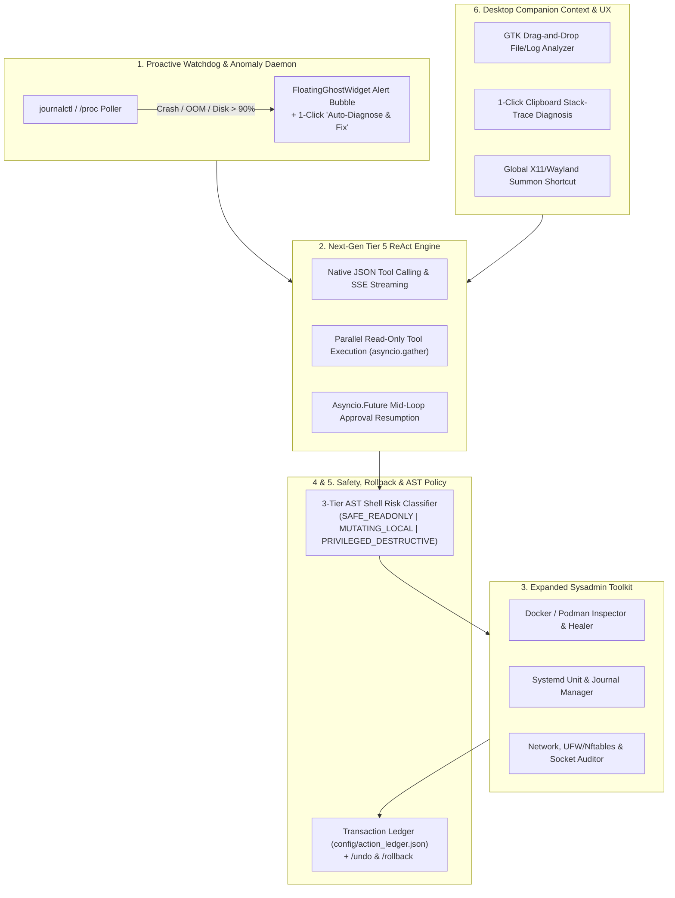

# Tchiko Assistant — Advanced Architecture & Feature Improvements Roadmap

This document outlines the next-generation architectural and functional improvements for **Tchiko Assistant** (`Tchiko-Assistant-Sysadmin-companion`), grounded directly in the current codebase (`tchiko/`).

---

## Overview of Proposed Enhancements

---

## 1. Proactive Background Watchdog & Anomaly Detection Daemon

### Current Limitation
[`LinuxSystemToolkit`](tchiko/system_tools.py) and [`TchikoAssistantWindow._refresh_telemetry`](tchiko/assistant_window.py) currently poll `/proc` metrics passively every 3 seconds only to update UI progress bars when the window is open.

### Proposed Improvement
- **New Module / Class**: `SystemWatchdog` in `tchiko/system_tools.py` (or `tchiko/watchdog.py`).
- **Real-Time Telemetry & Failure Stream**:
  - Subscribe asynchronously to `journalctl -f -p err..emerg -o json` to catch service crashes, segfaults, and OOM-killer events as they happen.
  - Monitor resource pressure thresholds: RAM usage > 90%, `/home` or `/` disk usage > 90%, CPU load spike > `2x` core count, defunct/zombie process accumulation, and expiring local TLS certificates.
- **Desktop Companion Integration**:
  - When an anomaly is detected, transition [`FloatingGhostWidget`](tchiko/ghost_widget.py) to the `"alert"` emotion state.
  - Display a proactive speech bubble above Tchiko summarizing the issue with a **1-click `"🛠️ Auto-Diagnose & Fix"` button** that feeds the captured log trace directly into [`TchikoAgentEngine.process_prompt_async`](tchiko/agent_engine.py).

---

## 2. Upgrade Tier 5 ReAct Loop to Native Structured Tool Calling & Parallel Execution

### Current Limitation
In [`TchikoAgentEngine._try_external_llm_with_tools`](tchiko/agent_engine.py):
1. Tool calls rely on regex parsing of custom XML tags (`<view_file>`, `<grep>`, `<patch_file>`, `<write_file>`, `<bash>`) via [`_extract_tool_actions`](tchiko/agent_engine.py).
2. Only `actions[0]` is executed per iteration (dropping subsequent tool calls emitted in the same turn).
3. [`_call_gemini_rest`](tchiko/agent_engine.py) and [`_call_local_ollama`](tchiko/agent_engine.py) use blocking `urllib.request.urlopen` calls without token streaming.
4. When `requires_manual_review()` is triggered during the ReAct loop, the loop exits early after running a single approved command instead of continuing multi-step reasoning.

### Proposed Improvement
- **Native Function Calling & Streaming SSE**:
  - Upgrade Gemini REST (`streamGenerateContent`) and Local Ollama (`/api/chat` with `"stream": true` and `"tools": [...]`) to stream tokens live into `on_token` and use structured JSON tool schemas.
- **Parallel Tool Execution**:
  - Partition extracted tool calls into read-only tools (`view_file`, `grep_files`, `get_system_telemetry`, `list_directory`) and state-mutating tools (`patch_file_content`, `write_file_content`, `run_shell_command`).
  - Run read-only tool batches concurrently with `await asyncio.gather(...)` and return all observations in a single ReAct turn.
- **Pause-and-Resume Approval via `asyncio.Future`**:
  - Replace the early `return True` on manual approval with an `asyncio.Future` bridged to `GLib.idle_add` so that once the user clicks **Approve** in [`TchikoAssistantWindow`](tchiko/assistant_window.py), the ReAct loop resumes at step `N+1` with the command output.

---

## 3. Container, Systemd & Network Security Toolkit Expansion

### Current Limitation
[`LinuxSystemToolkit`](tchiko/system_tools.py) focuses primarily on basic process listing (`ps`), file read/grep/patch, and the 6-step application crash doctor ([`diagnose_and_heal_app`](tchiko/system_tools.py)).

### Proposed Improvement
Expand [`LinuxSystemToolkit`](tchiko/system_tools.py) and Tier 1/Tier 3 planners in [`TchikoAgentEngine`](tchiko/agent_engine.py) with dedicated sysadmin subsystems:
- **Docker & Podman Container Doctor (`diagnose_containers`)**:
  - Inspect running and exited containers (`docker ps -a --format json`), analyze exit codes (e.g., `137` OOMKilled, `1` app crash), tail container logs, verify volume/port bindings, and offer 1-click container restart or image pruning.
- **Systemd Service & Timer Manager (`manage_systemd_unit`)**:
  - Query user (`systemctl --user`) and system units, list failed units (`systemctl --failed`), inspect unit dependency trees, and extract unit-specific journal logs (`journalctl -u <service> -n 100`).
- **Network & Firewall Auditor (`audit_network_security`)**:
  - Map listening ports to processes (`ss -tulnp`), inspect active `ufw` / `nftables` rules, test DNS resolution and TLS handshake latency, and audit active SSH connections/tunnels.

---

## 4. Snapshot & Rollback Transaction Ledger (Undoable Sysadmin Actions)

### Current Limitation
[`LinuxSystemToolkit.patch_file_content`](tchiko/system_tools.py) and [`write_file_content`](tchiko/system_tools.py) overwrite a single `<file>.bak` backup path, and [`config/agent_memory.json`](tchiko/agent_engine.py) only tracks `last_artifact_path`. Multi-file patches or repeated edits cannot be cleanly rolled back as a unit.

### Proposed Improvement
- **Transaction Ledger (`config/action_ledger.json`)**:
  - Record an immutable entry for every file write, patch, or mutating command with:
    - `tx_id`, `timestamp`, `prompt`, `operation` (`patch` | `write` | `bash`), `target_path`, `sha256_before`, `sha256_after`, `unified_diff`, and a timestamped snapshot file under `config/snapshots/<tx_id>/`.
- **Instant Rollback Commands & UI Controls**:
  - Add `/undo` and `/rollback [tx_id]` slash commands to [`TchikoAgentEngine._try_handle_slash_commands`](tchiko/agent_engine.py).
  - Add an interactive **`↩️ Undo Patch`** button on file-modification cards inside [`TchikoAssistantWindow`](tchiko/assistant_window.py).

---

## 5. AST-Aware Command Policy & Risk Scoring

### Current Limitation
[`ConfigManager.is_command_allowed`](tchiko/config_manager.py) checks commands using simple substring matching against `command_denylist`, and [`LinuxSystemToolkit.run_shell_command`](tchiko/system_tools.py) executes raw strings via `/bin/bash -lc`.

### Proposed Improvement
- **3-Tier Command Risk Classifier** in [`ConfigManager`](tchiko/config_manager.py):
  - Parse chained shell expressions (`;`, `&&`, `||`, `|`, `$()`, backticks, `>`, `>>`) into individual command tokens.
  - Classify each pipeline into one of three risk tiers:
    1. `SAFE_READONLY`: `ls`, `pwd`, `whoami`, `df`, `free`, `ps`, `uptime`, `cat`, `head`, `tail`, `grep`, `find` (without `-delete`/`-exec`), `git status`, `git log`, `git diff`, `journalctl`, `systemctl status`, `openssl x509`.
    2. `MUTATING_LOCAL`: `mkdir`, `cp`, `mv`, `git init`, `git checkout`, `pip install`, `npm install`, `ssh-keygen`.
    3. `PRIVILEGED_DESTRUCTIVE`: `sudo`, `rm -rf`, `mkfs`, `dd`, `chmod -R`, `chown`, `kill -9`, `pkill`, `systemctl stop/disable`, `ufw`, `iptables`, `curl ... | sh`.
- **Smart Policy Enforcement**:
  - In **Supervised Review Mode**, automatically allow `SAFE_READONLY` diagnostic commands so Tchiko can investigate problems freely without nagging the user, while pausing for interactive approval before executing `MUTATING_LOCAL` or `PRIVILEGED_DESTRUCTIVE` actions.
  - Enforce hard guardrails on `PRIVILEGED_DESTRUCTIVE` commands even when `approve_all_system_permissions` is enabled, unless explicitly confirmed.

---

## 6. Desktop Context Awareness, Drag-and-Drop & Global Hotkey

### Current Limitation
[`FloatingGhostWidget`](tchiko/ghost_widget.py) supports mouse click/drag, scroll-wheel emotion cycling, and middle-click to toggle the quick-input pill, but cannot accept dropped files or be summoned from the keyboard.

### Proposed Improvement
- **Drag-and-Drop Target (`drag_dest_set`)**:
  - Enable GTK3 URI/text drag-and-drop on [`FloatingGhostWidget`](tchiko/ghost_widget.py):
    - Drop a `.log` or `.dmp` file → Tchiko automatically parses error stack traces and explains the root cause.
    - Drop a `.sh` or `.py` script → Tchiko audits the script for bugs/security issues.
    - Drop a directory → Tchiko switches its working directory (`cwd`) and summarizes the project structure.
- **1-Click Clipboard & Selection Diagnosis**:
  - Add a quick action button (or right-click context menu item) on [`FloatingGhostWidget`](tchiko/ghost_widget.py) to inspect the current X11/Wayland primary selection or clipboard — allowing users to highlight a terminal error and click Tchiko for an instant fix.
- **Global Keybinding & System Tray (`AppIndicator3`)**:
  - Register a global desktop shortcut (e.g., `Super+Shift+T` via `Keybinder` or XDG Desktop Portal) to summon and focus Tchiko's quick-input bar from any workspace.
  - Add an optional `AppIndicator3` top-panel indicator icon so Tchiko can be hidden/restored or switched between *Autonomous* and *Review* modes from the Ubuntu top bar.

---

## Summary Implementation Priority Matrix

| Priority | Feature / Improvement | Primary Files Affected | Complexity | Impact |
| :--- | :--- | :--- | :---: | :---: |
| **P0** | AST-Aware Command Risk Classifier & Smart Review Policy | `tchiko/config_manager.py`, `tchiko/system_tools.py` | Low | High |
| **P0** | Snapshot & Rollback Transaction Ledger (`/undo`) | `tchiko/system_tools.py`, `tchiko/agent_engine.py`, `tchiko/assistant_window.py` | Medium | High |
| **P1** | Native Tool Calling, Parallel Read Tools & Mid-Loop Approval Future | `tchiko/agent_engine.py` | Medium | High |
| **P1** | Container (Docker/Podman), Systemd & Network Security Toolkit | `tchiko/system_tools.py`, `tchiko/agent_engine.py` | Medium | High |
| **P2** | Proactive Background Watchdog & Anomaly Alert Bubble | `tchiko/system_tools.py`, `tchiko/ghost_widget.py`, `main.py` | Medium | High |
| **P2** | Drag-and-Drop File Analyzer, Clipboard Context & Global Hotkey | `tchiko/ghost_widget.py`, `main.py` | Low–Med | Medium |
