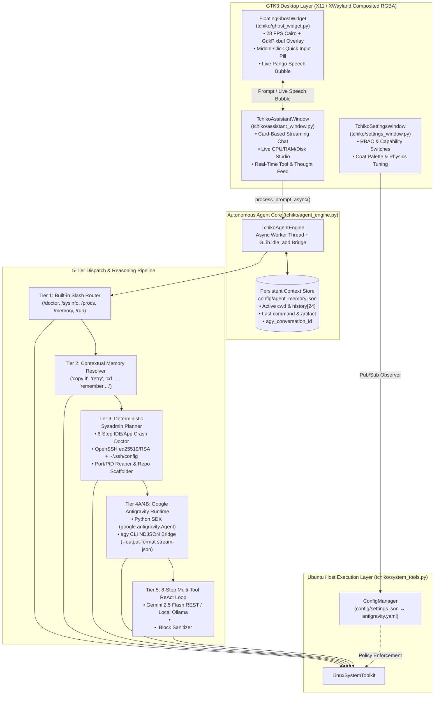
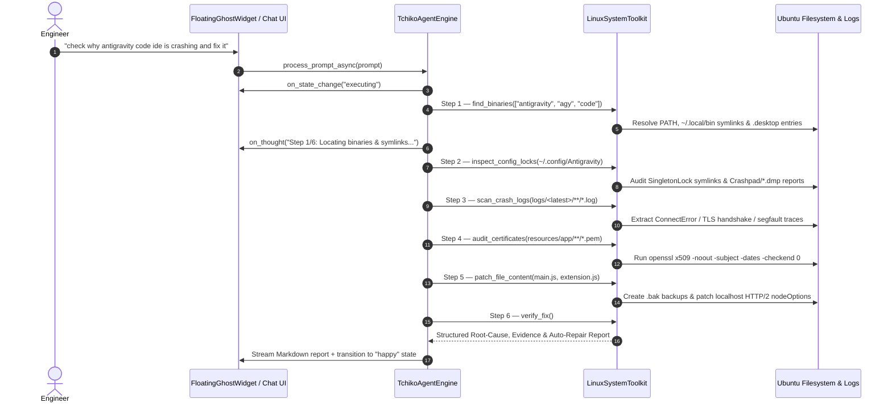

# Tchiko-Assistant-Sysadmin-companion

<div align="center">
  

  # 🐾 TCHIKO ASSISTANT
  **Autonomous Linux Systems Engineer, DevOps Companion & Parametric Cairo Desktop Agent**

  [](antigravity.yaml)
  [](pyproject.toml)
  [](tchiko/svg_ghost_renderer.py)
  [](main.py)
  [](#license)

  **[📐 Architecture Deep-Dive (`docs/ARCHITECTURE.md`)](docs/ARCHITECTURE.md)** • **[🛠️ Contributing Guide (`CONTRIBUTING.md`)](CONTRIBUTING.md)** • **[🌐 Interactive Web Showcase (`landing/index.html`)](landing/index.html)**
</div>

---

## 1. Executive Summary

**Tchiko Assistant** (`Tchiko-Assistant-Sysadmin-companion`) is an open-source, autonomous Linux systems engineering agent and floating desktop companion for **Ubuntu Linux**. Inspired by the mythical six-legged, four-winged **Dijiang (Hundun)** and built on the **Google Antigravity SDK & CLI (`agy`)**, Tchiko combines:

1. **A 5-Tier Autonomous Agent Engine (`tchiko/agent_engine.py`)** capable of multi-step root-cause investigation, log & stack-trace analysis, X.509 certificate auditing, automated binary/source patching with `.bak` rollback safety, OpenSSH key lifecycle management, and real-time NDJSON IPC streaming with `agy`.
2. **A Deterministic & ReAct Linux System Toolkit (`tchiko/system_tools.py`)** providing direct `/proc` telemetry, line-numbered file inspection (`view_file_lines`), minified-bundle-aware regex search (`grep_files`), atomic file patching (`patch_file_content`), and a 6-step **Autonomous Application Crash Doctor (`diagnose_and_heal_app`)**.
3. **A 60 FPS Parametric Cairo Vector & Spring-Jelly Physics Renderer (`tchiko/svg_ghost_renderer.py`)** that renders Tchiko procedurally using closed cubic Bézier splines (32 fur puffs, 4 articulated multi-layered wings, 6 animated paws) with area-conserving Hooke's law squash-and-stretch dynamics (`squish_x`, `squish_y`), exported identically to both `GdkPixbuf` surfaces and standalone SVG assets.

---

## 2. System Architecture & Execution Pipeline



### Multi-Step Autonomous Investigation Sequence

When asked to diagnose and fix a failing Linux application (for example: *"can you check why antigravity code ide is not working and crashing fix it"*), Tchiko executes a structured 6-stage engineering workflow:



---

## 3. Repository Structure

```text
Tchiko-Assistant-Sysadmin-companion/
├── main.py                        # CLI entry point, X11/Wayland bootstrap, --self-test runner & GTK lifecycle
├── run_tchiko.sh                  # Zero-config launcher (provisions .venv with --system-site-packages)
├── pyproject.toml                 # PEP 621 package metadata, console_scripts, ruff/mypy/pytest config
├── Makefile                       # Developer workflow targets (run, test, doctor, export-svg, clean)
├── antigravity.yaml               # Declarative Antigravity agent policy (auto-synced by ConfigManager)
├── netlify.toml                   # Netlify deployment specification for the interactive web showcase
├── requirements.txt               # Optional Python dependencies (google-antigravity SDK)
├── Tchiko-Assistant.desktop       # Freedesktop.org XDG desktop launcher specification
│
├── tchiko/                        # Core Python Package
│   ├── __init__.py                # Package version, metadata & public API exports
│   ├── agent_engine.py            # 5-Tier Autonomous Agent Engine, agy NDJSON bridge & 8-step ReAct loop
│   ├── system_tools.py            # Ubuntu Linux toolkit: /proc telemetry, file view/grep/patch & Crash Doctor
│   ├── config_manager.py          # Thread-safe pub/sub config store & antigravity.yaml policy synchronizer
│   ├── svg_ghost_renderer.py      # Parametric Cairo Bézier renderer, spring-jelly physics & SVG exporter
│   ├── ghost_widget.py            # Frameless RGBA GTK3 overlay, middle-click quick pill & speech bubble
│   ├── assistant_window.py        # Antigravity 2.0-styled Chat, System Studio & real-time Activity feed
│   └── settings_window.py         # RBAC permission control panel & visual physics customizer
│
├── config/
│   ├── settings.json              # Persisted runtime settings, RBAC capabilities & window coordinates
│   └── agent_memory.json          # Auto-managed conversational memory, cwd, notes & agy_conversation_id
│
├── docs/
│   └── ARCHITECTURE.md            # Deep engineering specification (physics math, IPC schema, security model)
│
├── tests/
│   └── test_engine_and_tools.py   # Automated unit & integration test suite (unittest / pytest compatible)
│
├── assets/                        # Procedurally exported desktop SVGs & raster previews
│   ├── tchiko-logo.svg            # Canonical idle pose vector exported directly by SvgGhostRenderer
│   └── tchiko-*.svg               # Emotion study vectors (love, happy, roar, executing, sleepy, thinking)
│
└── landing/                       # Self-contained interactive HTML5 Canvas + SVG showcase for Netlify
    ├── index.html                 # 1:1 JavaScript port of SvgGhostRenderer + interactive terminal demo
    ├── _redirects                 # Netlify SPA routing rules
    └── assets/                    # Mirrored vector assets for zero-dependency static hosting
```

---

## 4. Deep-Dive: Core Engineering Subsystems

### 4.1. Antigravity CLI (`agy`) Real-Time NDJSON Stream Bridge
When `/home/level-78/.local/bin/agy` (or `agy` in `PATH`) is available, [`TchikoAgentEngine._run_agy_cli_stream_json()`](tchiko/agent_engine.py) spawns a non-blocking subprocess:

```bash
agy -p "<prompt>" --output-format stream-json --add-dir "<cwd>" --dangerously-skip-permissions --conversation "<id>"
```

It consumes the newline-delimited JSON (`NDJSON`) stream over `asyncio.subprocess.PIPE`:
- **`{"event": "init"}`**: Captures and persists `conversation_id` into `config/agent_memory.json` (`agy_conversation_id`) so subsequent prompts maintain full multi-turn context across the 48+ native Antigravity tools.
- **`{"event": "step_update", "step_update": {"step_type": "tool"}}`**: Transitions Tchiko's desktop avatar into the `"executing"` state (`Ten-Rings Overdrive`) and streams the active tool name and JSON arguments into both the **Activity log** and **Tchiko's floating desktop speech bubble**.
- **`{"event": "step_update", "step_update": {"step_type": "agent_response"}}`**: Streams `text_delta` chunks directly into the GTK chat card and desktop bubble with sub-10ms latency.

### 4.2. 8-Step Multi-Tool ReAct Loop & `<think>` Sanitizer (Offline / REST Mode)
When running against **Local Ollama** (`gemma4:e4b`, `qwen2.5-coder:1.5b`, `llama3.2:latest`, `lfm2.5:8b`) or the **Gemini 2.5 Flash REST API**, [`TchikoAgentEngine._try_external_llm_with_tools()`](tchiko/agent_engine.py) executes up to **8 autonomous reasoning-and-action turns**:

1. **Reasoning Isolation (`_strip_think_blocks`)**: Extracts `<think>...</think>` blocks (including truncated unclosed blocks) *before* tool parsing. Reasoning summaries are routed to `on_thought()`, preventing internal chain-of-thought examples (such as `<bash>COMMAND</bash>`) from ever leaking into command execution or chat output.
2. **Structured XML Tool Protocol (`_extract_tool_actions`)**:
   - `<view_file path="/path/to/file" start="1" end="120" />` → [`LinuxSystemToolkit.view_file_lines()`](tchiko/system_tools.py)
   - `<grep pattern="ConnectError" path="~/.config/Antigravity/logs" />` → [`LinuxSystemToolkit.grep_files()`](tchiko/system_tools.py) (includes an automatic byte-window fallback for single-line minified JS bundles like `main.js`)
   - `<patch_file path="/path/to/file"><search>...</search><replace>...</replace></patch_file>` → [`LinuxSystemToolkit.patch_file_content()`](tchiko/system_tools.py) (creates an automatic `.bak` backup prior to atomic replacement)
   - `<write_file path="/path/to/file">...</write_file>` → [`LinuxSystemToolkit.write_file_content()`](tchiko/system_tools.py)
   - `<bash>...</bash>` → [`LinuxSystemToolkit.run_shell_command()`](tchiko/system_tools.py)
3. **Closed-Loop Observation Feedback**: After each tool execution, `stdout`/`stderr`, exit codes, and file diffs are fed back into the rolling prompt until the root cause is resolved.

### 4.3. Parametric Cairo Vector & Spring-Jelly Physics Engine
Unlike sprite-based desktop pets that rely on static PNG frames, [`SvgGhostRenderer`](tchiko/svg_ghost_renderer.py) is a pure mathematical vector engine:
- **Damped Harmonic Oscillator Squash & Stretch**:
  $$\ddot{s}_x = -k (s_x - \hat{s}_x) - c \dot{s}_x, \qquad s_y \approx \frac{1}{s_x}$$
  where $k = 18.0$ is the spring stiffness and $c = 0.72$ is the damping factor, preserving cross-sectional area during boops, drags, and hover petting.
- **32-Puff Closed Cubic Bézier Silhouette**: Computes 32 radial anchor points modulated by polar harmonic waves ($\cos(6\theta)$, $\sin(3\theta)$) to form a seamless cloud-soft body with zero sharp vertices.
- **Dual-Surface Pipeline**: The exact same `_draw_scene(ctx, width, height, theme_name, opacity)` method renders to `cairo.ImageSurface` (for 28 FPS GTK3 `GdkPixbuf` animation) and `cairo.SVGSurface` (for lossless `.svg` asset generation).

---

## 5. Desktop Interaction Matrix

| Input / Gesture | Target Surface | System Behavior |
| :--- | :--- | :--- |
| **Middle-Click (Scroll-Wheel Click)** | Floating Tchiko Avatar | Toggles the inline **Quick Input Pill (`Ask Tchiko... ↵`)** directly underneath Tchiko and grabs keyboard focus. |
| **`Enter` (`↵`) in Quick Input** | Quick Input Pill | Dispatches the prompt to `TchikoAgentEngine`, hides the input pill, and streams live tool progress & markdown replies into the **Talking Speech Bubble** above Tchiko. |
| **Single Left-Click** | Floating Tchiko Avatar | Toggles the full **Tchiko Chat & System Studio** window (`💬 Chat`, `⚡ System Studio`, `🧠 Activity`), plus triggers a squishy boop impulse (`squish_x = 1.24, squish_y = 0.78`). |
| **Left-Click + Drag** | Floating Tchiko Avatar | Repositions Tchiko across the X11/XWayland root window with velocity-coupled leg-dangle physics and persists `(position_x, position_y)` to `config/settings.json`. |
| **Cursor Hover / Rubbing** | Floating Tchiko Avatar | Accumulates `_pet_rub_energy`; transitions Tchiko into the `love` state with musical chirp particles (`♪`) once rub threshold is reached. |
| **Scroll Wheel Up / Down** | Floating Tchiko Avatar | Cycles deterministically through all **10 procedural states**: `idle`, `love`, `happy`, `roar`, `wing_slash`, `excited`, `thinking`, `executing`, `sleepy`, `dizzy`. |
| **Double Left-Click / Right-Click** | Floating Tchiko Avatar | Opens **Tchiko Settings & System Permissions** (`⚙️`) or the quick sysadmin context menu. |

---

## 6. Installation, Self-Test & Usage

### 6.1. System Requirements (Ubuntu 22.04 / 24.04 / 25.10)
Tchiko uses Ubuntu's native system `python3-gi` and `python3-cairo` bindings for zero-overhead GTK3 compositing:

```bash
sudo apt update && sudo apt install -y \
    python3 python3-venv python3-gi python3-gi-cairo gir1.2-gtk-3.0 xclip
```

### 6.2. Clone, Verify & Launch

```bash
# 1. Clone the repository
git clone git@github.com:ZYNIQ-SOLUTIONS/Tchiko-Assistant-Sysadmin-companion.git
cd Tchiko-Assistant-Sysadmin-companion

# 2. Run the automated verification suite (ConfigManager, LinuxSystemToolkit, AgentEngine, Cairo SVG pipeline)
python3 main.py --self-test

# 3. Run the unit & integration test suite
python3 -m unittest discover -s tests -v

# 4. Launch the floating desktop companion
./run_tchiko.sh
```

### 6.3. Command-Line Interface Flags

```bash
python3 main.py --help
# Options:
#   --self-test      Run automated self-tests, verify Linux toolkit, and export canonical SVGs without opening GUI
#   --open-chat      Open the full Tchiko Chat & System Studio window alongside the floating companion on startup
#   --open-settings  Open the Tchiko Settings & RBAC Permissions window on startup
```

---

## 7. Built-In Slash Commands & Natural-Language Sysadmin Playbook

| Command / Natural Prompt | Execution Tier | Action Performed |
| :--- | :--- | :--- |
| `/doctor` or *"diagnose my system"* | Tier 1 / Tier 3 | Runs a 5-point Ubuntu health audit (`/proc` CPU/RAM/Disk thresholds, top CPU processes, failed `systemd` units, listening TCP/UDP sockets). |
| *"check why antigravity code ide is crashing and fix it"* | Tier 3 (`diagnose_and_heal_app`) | Runs the 6-step IDE Crash Doctor: resolves binaries/symlinks, inspects `SingletonLock` & `Crashpad`, scans `main.log`/`exthost.log`, audits X.509 `.pem` expiry via `openssl`, and patches `main.js`/`extension.js` with `.bak` backups. |
| *"create an ssh key for my hetzner server in OpenSSH format"* | Tier 3 (SSH Lifecycle) | Generates `~/.ssh/id_ed25519_hetzner` (`-a 100`), sets `0600`/`0644` permissions, backs up any prior key, and auto-copies the `.pub` key to the X11/Wayland clipboard. |
| *"add hetzner server 95.216.10.20 to ssh config user ubuntu"* | Tier 3 (SSH Config) | Appends a `Host hetzner` stanza with `IdentityFile` and `ServerAliveInterval 60` to `~/.ssh/config` (`0600`). |
| *"what is using port 8000"* / *"kill port 3000"* | Tier 3 (Port Doctor) | Inspects listening sockets via `ss -tulnp` / `lsof -i` or reaps processes bound to the target port. |
| *"remember my staging ip is 10.10.0.42"* / `/memory` | Tier 2 (Context Store) | Persists key-value facts into `config/agent_memory.json` and injects them into all subsequent LLM/Antigravity prompts. |
| *"copy it"* / *"retry"* / *"where did you save it?"* | Tier 2 (Follow-Up Resolver) | Copies `last_artifact_content` to clipboard, re-executes `last_command`, or displays `last_artifact_path`. |
| `/sysinfo`, `/procs`, `/files [path]`, `/permissions` | Tier 1 (Slash Router) | Direct zero-latency inspection of `/proc` telemetry, top processes, directory listings, and RBAC state. |
| `$ <cmd>` or `/run <cmd>` | Tier 1 (Direct Shell) | Executes `<cmd>` in the agent's persistent working directory (`cwd`) governed by `ConfigManager` policy. |

---

## 8. Security & Permission Governance (`ConfigManager`)

All host interactions in [`LinuxSystemToolkit`](tchiko/system_tools.py) are gated by [`ConfigManager`](tchiko/config_manager.py), which maintains bi-directional synchronization between [`config/settings.json`](config/settings.json) and [`antigravity.yaml`](antigravity.yaml):

- **Master Autonomous Mode (`approve_all_system_permissions: true`)**: Grants full passwordless execution across all 6 capability domains (`bash_execution`, `filesystem_read_write`, `process_management`, `desktop_automation`, `package_management`, `network_requests`) and passes `--dangerously-skip-permissions` to the `agy` CLI bridge.
- **Supervised Review Mode (`tool_execution_policy: "request-review"`)**: Queues any shell mutation or file patch and presents an inline approval banner (`✅ Run Command` | `🛡️ Always Allow All` | `✖ Cancel`) inside the Chat window before execution.
- **Command Denylist (`command_denylist`)**: Enforces substring & pattern blocking prior to subprocess creation even when autonomous mode is active.

---

## 9. License

Released under the **MIT License**. Crafted by **ZYNIQ SOLUTIONS** for Linux systems engineers, SREs, and AI agent developers.
