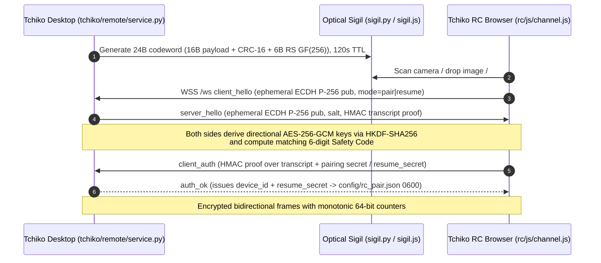

# Tchiko Assistant — Technical Architecture & Engineering Specification

This document details the internal architecture, IPC protocols, mathematical rendering pipeline, and security model of **Tchiko Assistant (`Tchiko-Assistant-Sysadmin-companion`)**.

---

## 1. Architectural Design Principles

1. **Zero-Latency Local Determinism First, Deep Agentic Reasoning Second:**
   Common sysadmin operations (`/proc` telemetry, OpenSSH key generation, port reaping, directory scaffolding, and known IDE crash signatures) execute deterministically in `<15ms` without waiting on network LLM round-trips. Complex, open-ended debugging tasks seamlessly escalate to the **Google Antigravity SDK / `agy` CLI NDJSON stream bridge** or the **8-step Multi-Tool ReAct Engine**.
2. **Thread-Isolated Async I/O with GTK Main-Loop Safety:**
   GTK3 is strictly single-threaded. `TchikoAgentEngine.process_prompt_async()` spawns a daemon worker thread running an `asyncio` event loop, while all UI mutations (`on_thought`, `on_tool_call`, `on_token`, `on_complete`, `on_state_change`) are marshaled back onto the GTK thread via `GLib.idle_add()`.
3. **Pure Procedural Vector Graphics (Zero Sprite Bloat):**
   Every frame of Tchiko is synthesized mathematically in `SvgGhostRenderer._draw_scene()` using `pycairo`. The exact same drawing code targets `cairo.ImageSurface` (for 28 FPS desktop animation) and `cairo.SVGSurface` (for canonical vector export).
4. **Backup-First Atomic Self-Healing:**
   Whenever `LinuxSystemToolkit.patch_file_content()` or `write_file_content()` modifies a host configuration file or application bundle, it atomically copies the original file to `<filename>.bak` before writing changes.

---

## 2. 5-Tier Prompt Dispatch & Reasoning Engine (`tchiko/agent_engine.py`)

When a prompt enters `TchikoAgentEngine._handle_prompt()`, it traverses five prioritized execution tiers:

### Tier 1: Built-in Slash Command Router (`_try_handle_slash_commands`)
Handles explicit operator commands (`/doctor`, `/sysinfo`, `/procs`, `/files [path]`, `/open <target>`, `/memory [clear]`, `/permissions`, `/grant-all`, `/revoke-all`, `/run <cmd>`, `$ <cmd>`).

### Tier 2: Persistent Contextual Memory Resolver (`_try_contextual_followup`)
Reads and updates `config/agent_memory.json`:
```json
{
  "cwd": "/home/<user>",
  "last_command": "ss -tulnp | head -n 30",
  "last_output": "...",
  "last_artifact_path": "/home/<user>/.ssh/id_ed25519_hetzner.pub",
  "last_artifact_content": "ssh-ed25519 AAAAC3NzaC1lZDI1NTE5AAAA...",
  "agy_conversation_id": "5a6241b1-bdf8-4126-ba6c-0813df6bdded",
  "notes": {
    "hetzner ip": "95.216.10.20"
  },
  "history": []
}
```
Resolves anaphoric references such as `"copy it"` (copies `last_artifact_content` or `last_output` to the X11/Wayland clipboard via `xclip`/`xsel`/`wl-copy`), `"retry"` (re-runs `last_command`), `"where did you save it?"`, `"cd <dir>"`, and `"remember that <key> is <value>"`.

### Tier 3: Deterministic Linux & DevOps Action Planner (`_try_autonomous_linux_action`)
Maps structured natural-language sysadmin intents to multi-step host pipelines:
- **6-Step Autonomous IDE & App Crash Doctor (`_run_ide_crash_doctor` → `diagnose_and_heal_app`)**
- **5-Point Ubuntu System Doctor (`_run_system_doctor`)**
- **OpenSSH Keypair & `~/.ssh/config` Lifecycle Manager**
- **Port & Process Reaper (`lsof -t -i:<port>` / `ss -tulnp`)**
- **Workspace & Git Repository Scaffolder**

### Tier 4A & 4B: Google Antigravity SDK & `agy` CLI Stream-JSON Bridge
- **Tier 4A (`google.antigravity` Python SDK):** Streams `response.thoughts`, `response.tool_calls`, and `response` tokens using `LocalAgentConfig` and `CapabilitiesConfig`.
- **Tier 4B (`_run_agy_cli_stream_json`):** Spawns `~/.local/bin/agy -p <prompt> --output-format stream-json --add-dir <cwd>` (passing `--dangerously-skip-permissions` when autonomous mode is active and `--conversation <agy_conversation_id>` to preserve multi-turn state). Parses real-time NDJSON events:
  - `event == "init"` → stores `conversation_id`
  - `event == "step_update"` (`step_type == "tool"`) → emits live tool name & parameters to the UI
  - `event == "step_update"` (`step_type == "agent_response"`) → streams `text_delta` tokens immediately
  - `event == "result"` → completes turn

### Tier 5: 8-Step Multi-Tool ReAct Loop (`_try_external_llm_with_tools`)
Provides full autonomous investigation and repair when using **Gemini 2.5 Flash REST API** or **Local Ollama** (`gemma4:e4b`, `qwen2.5-coder:1.5b`, `llama3.2:latest`, `lfm2.5:8b`):
1. **Chain-of-Thought Sanitization (`_strip_think_blocks`)**: Strips `<think>...</think>` blocks (including unclosed `<think>` tags) and forwards a 1-line summary to `on_thought()`, guaranteeing that reasoning artifacts never trigger false tool calls.
2. **Multi-Tool Extraction (`_extract_tool_actions`)**: Parses `<view_file>`, `<grep>`, `<patch_file>`, `<write_file>`, and `<bash>` tags while filtering out placeholder strings (`COMMAND`, `YOUR_COMMAND_HERE`).
3. **Iterative Observation Loop**: Executes up to 8 tool steps, feeding the resulting `ToolResult.output` back into the rolling prompt until the model emits a final diagnosis without tool tags.

---

## 3. Parametric Cairo Vector & Spring-Jelly Physics (`tchiko/svg_ghost_renderer.py`)

### 3.1. Damped Spring-Jelly Dynamics
Tchiko's body deformation is governed by two coupled state variables (`squish_x`, `squish_y`) with velocity (`squish_vx`, `squish_vy`) and target equilibrium ($\hat{s}_x, \hat{s}_y$):

```python
force_x = (target_sx - self.squish_x) * 18.0
force_y = (target_sy - self.squish_y) * 18.0
self.squish_vx = (self.squish_vx + force_x * dt) * 0.72
self.squish_vy = (self.squish_vy + force_y * dt) * 0.72
self.squish_x += self.squish_vx
self.squish_y += self.squish_vy
```

When the user clicks ("boops") or pets Tchiko, an instantaneous impulse (`squish_x = 1.24, squish_y = 0.78`) compresses vertical height while expanding horizontal width ($\Delta A \approx 0$), producing realistic marshmallow-mochi physics.

### 3.2. 32-Puff Polar Harmonic Silhouette
The torso boundary is parameterized over $N = 32$ angular stations $\theta_i = \frac{2\pi i}{N}$:
$$r_x(\theta) = R_x \left(1 + 0.08 \sin(\theta) + 0.032 \cos(6\theta + \phi) + \alpha_{\text{fur}} \cos(N\theta)\right)$$
$$r_y(\theta) = R_y \left(1 + 0.06 \sin(\theta) + 0.025 \sin(3\theta - \phi) + \alpha_{\text{fur}} \cos(N\theta)\right)$$
Adjacent midpoints are interpolated with closed cubic Bézier curves (`ctx.curve_to`), ensuring $C^1$ continuity across all 32 fur puffs.

---

## 4. X11 / XWayland Compositing & Input-Shape Hitmasking (`tchiko/ghost_widget.py`)

To ensure reliable frameless window positioning (`Gtk.Window.move(x, y)`) and always-on-top stacking (`set_keep_above(True)`) on Ubuntu GNOME Wayland sessions, `main.py` initializes:
```python
os.environ.setdefault("GDK_BACKEND", "x11,wayland")
```
`FloatingGhostWidget` requests an RGBA visual (`screen.get_rgba_visual()`) with `set_app_paintable(True)` so the background around Tchiko's silhouette is 100% transparent, while the interactive event boxes capture middle-click, left-click, drag, hover-petting, and scroll-wheel events.

---

## 5. Tactile Cyber-Physical Design System & Pango Renderer (`tchiko/ui_theme.py`, `rc/css/rc.css`)

Both the desktop surfaces (`FloatingGhostWidget`, `TchikoAssistantWindow`, `TchikoSettingsWindow`, `TchikoPairWindow`) and the **Tchiko RC** web console (`rc/index.html`, `rc/css/rc.css`) share a unified **Tactile Cyber-Physical Instrumentation Console** design language:
- **Design Tokens & CSS (`apply_theme`, `rc/css/rc.css`)**: Basalt/obsidian surfaces (`#0d0e11` / `#07080a`, `#14161a`, `#1a1d23`) with a micro-grid background, crisp `5px–6px` tactile keycap bevels, mechanical rocker switches with phosphor LEDs, `SYS.01` specimen CRT framing for BoopFace, vermilion crimson accent (`#e5484d`), and semantic status colors (`SUCCESS` `#3ecf8e`, `WARNING` `#f5a524`).
- **Coat & Mood Registries (`COAT_NAMES`, `MOOD_NAMES`, `rc/js/boopface.js`)**: Maps internal renderer keys (`phantom_cyan`, `astral_violet`, `emerald_matrix`, `solar_gold`) and emotion IDs consistently across PyCairo and Web SVG.
- **Resilient Markdown-to-Pango & DOM Renderers (`render_markdown_pango`, `rc/js/markdown.js`)**: Desktop converts streaming Markdown into strictly valid Pango markup; Tchiko RC renders XSS-safe DOM Markdown without innerHTML injection.
- **Telemetry Widgets (`RingGauge`)**: Cairo-drawn (desktop) and SVG-drawn (remote) circular gauges for CPU, RAM, and Disk utilization.

---

## 6. Tchiko RC — Encrypted Remote Control & Optical Sigil (`tchiko/remote/`, `rc/`)

**Tchiko RC** exposes full Tchiko Desktop parity to any mobile or desktop browser over an end-to-end encrypted WebSocket tunnel (`RemoteControlService`) served by a zero-dependency `asyncio` HTTPS + RFC 6455 WebSocket server (`tchiko/remote/server.py`).



### 6.1. Optical Tchiko Sigil (`tchiko/remote/sigil.py`, `rc/js/sigil.js`)
- **Codeword Layout (24 bytes / 192 bits)**:
  - `payload` (`16 B`): `version/flags` (`1 B`) | `session_id` (`3 B`) | one-time `pairing_secret` (`12 B`).
  - `message` (`18 B`): `payload` | `CRC-16/CCITT` (`2 B`).
  - `codeword` (`24 B`): `message` | `Reed-Solomon parity over GF(256)` (`6 B`, primitive polynomial `0x11D`), capable of repairing up to **3 corrupted bytes** (`24` total symbols).
- **Circular Ring Geometry**:
  - Drawn around the centered BoopFace specimen (`FACE_RADIUS = 0.40`) across three concentric rings of `72`, `64`, and `56` cells (`RING_RADII = (0.765, 0.645, 0.525)`), surrounded by a solid locator ring (`LOCATOR_INNER = 0.88`, `LOCATOR_OUTER = 1.0`).
  - Decoded in pure JavaScript (`rc/js/sigil.js`) via adaptive thresholding, ellipse/affine locator fitting, rotation alignment, and Berlekamp-Massey error correction.

### 6.2. Cryptographic Tunnel & Session Isolation (`tchiko/remote/crypto.py`, `rc/js/channel.js`)
- **Primitives**: Ephemeral **ECDH on NIST P-256** (with explicit curve-point validation), **HKDF-SHA256** key derivation (`RFC 5869`), **HMAC-SHA256** transcript verification, and **AES-256-GCM** (96-bit nonce, 128-bit tag).
- **Monotonic 64-Bit Counters**: Independent `DIR_CLIENT_TO_SERVER` and `DIR_SERVER_TO_CLIENT` monotonic sequence numbers bound to each AEAD nonce; any replay, drop, or out-of-order frame terminates the channel immediately.
- **Single-Device & Single-Connection Rule**: Pairing burns the 120s sigil immediately and overwrites `config/rc_pair.json` (`0600`). At most one authenticated WebSocket client may remain connected; authenticating a new session immediately evicts any prior client with close code `4009`.
- **Self-Signed TLS SAN Server (`tchiko/remote/server.py`)**: Automatically generates and caches `rc-cert.pem` + `rc-key.pem` (`0600`) in `~/.config/tchiko/` with SANs for `127.0.0.1` and active LAN IPv4 addresses, serving `rc/` with strict CSP (`default-src 'self'`), `X-Frame-Options: DENY`, and IP-scoped handshake failure rate limiting (`12 failures / 60s`).

---

## 7. Safety Governance, Skills & Watchdog (`config_manager.py`, `skills_loader.py`, `watchdog.py`)

- **3-Tier Shell Risk Classifier (`ConfigManager.classify_command`)**: Parses chained shell commands (`&&`, `||`, `;`, `|`) into `SAFE_READONLY`, `MUTATING_LOCAL`, or `PRIVILEGED_DESTRUCTIVE`. In Supervised Review mode, `SAFE_READONLY` telemetry commands run automatically while mutating/privileged commands require inline **Privileged Command Authorization** (mirrored to both Desktop and Tchiko RC).
- **Snapshot & Rollback Ledger (`config/snapshots/`, `config/action_ledger.json`)**: Records SHA-256 checksums and pre-edit file snapshots prior to any `patch_file_content()` or `write_file_content()` call, allowing `/undo` or `/rollback <tx_id>` restoration.
- **Pluggable Skills (`tchiko/skills_loader.py`, `skills/*.md`)**: Loads YAML-frontmatter Markdown runbooks (`nginx-tls-audit`, `postgres-doctor`, `gpu-cuda-doctor`, `git-recovery`) and injects matching procedures into agent prompts.
- **Proactive System Watchdog (`tchiko/watchdog.py`)**: Polls RAM, disk capacity, and failed `systemd` units in the background with cooldown deduplication, surfacing alerts on the floating desktop companion.

